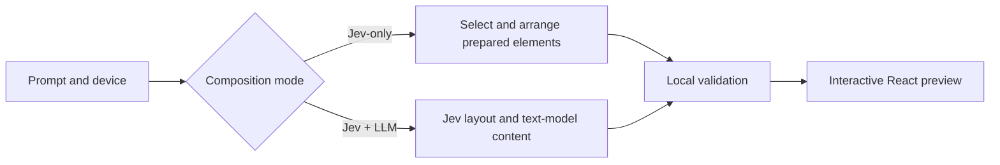

# Jeverative

A generative UI playground: describe an interface, choose a device size and compose an interactive preview from a prepared component library. **Jev-only**, the default, uses Jev decisions to select and arrange components without a separate text-generation model.

[Try Jeverative](https://jeverative-ui.vercel.app) · [Jev-only guide](docs/JEV-FIRST.md) · [Component capabilities](docs/CONFIGURABLE-COMPONENTS.md)

## Run locally

Requires **Node.js 22.13+** and npm. Live generation requires an OpenRouter key, supplied in the interface or through a local environment file.

```sh
git clone https://github.com/hckmstrrahul/jeverative-ui.git
cd jeverative-ui
npm ci
npm run dev
```

Open the local URL printed by the development server. Choose **Enter your key** to connect your OpenRouter account. For a server-side local default, copy `.env.example` to `.env.local`, set `OPENROUTER_API_KEY` and restart the server. Keep that file uncommitted.

## Compose an interface

1. Choose desktop, tablet or mobile.
2. Describe a screen, or select an example to fill the prompt. Include the names, copy, fields or data you want to use.
3. Select **Jev-only** or **Jev + LLM**, then choose **Compose**.
4. Try the preview's forms and controls, or generate a variation that reuses selected content.

The library covers profiles, dashboards, portfolios, planners, feeds, booking and fintech flows. Controls demonstrate local interactions and validation; they do not book travel, move money or connect to business backends.

## Composition modes

| Mode | How it works | Use it for |
| --- | --- | --- |
| **Jev-only** | One or two Jev calls select, configure, group and order prepared elements. Local code assembles and validates the result. | Interfaces supported by the prepared library and supplied content. |
| **Jev + LLM** | Jev chooses the layout; a text model supplies content and component structure, with at most one correction when enabled. | Requests needing more open-ended copy or combinations. |

Jev + LLM is an explicit choice and adds text-model usage and latency. Neither mode creates new React components or executes model-generated JavaScript. Failed generation preserves the previous completed screen. Coverage and quality depend on the available components, supplied data and provider responses.



## Development and hosting

```sh
npm test
npm run typecheck
npm run lint
npm run build
```

The app uses React, Vinext/Vite and a shared renderer with styled shadcn/ui components. `npm run build` creates the Cloudflare-targeted build; `npm start` previews it with Wrangler. Vercel uses the separate `npm run build:vercel` target.

OpenRouter calls go through server routes. A shared production key requires server-side `OPENROUTER_API_KEY` and `ALLOW_SHARED_OPENROUTER_KEY=true`; keep it in sensitive production environment variables. Visitors can override it with their own key. Never expose a default key through `NEXT_PUBLIC_*`, `VITE_*` or client code.

| Guide | Covers |
| --- | --- |
| [Jev-only](docs/JEV-FIRST.md) | Selection, layout rules, variations and limits. |
| [Composition engine](docs/COMPOSITION-ENGINE.md) | Jev-directed layout, content generation and validation. |
| [Configurable components](docs/CONFIGURABLE-COMPONENTS.md) | Supported properties and supplied content. |
| [Fintech workflows](docs/FINTECH-WORKFLOWS.md) | Forms, review states and simulated outcomes. |
| [Mint integration](docs/MINT-INTEGRATION.md) | Component styling and design references. |
